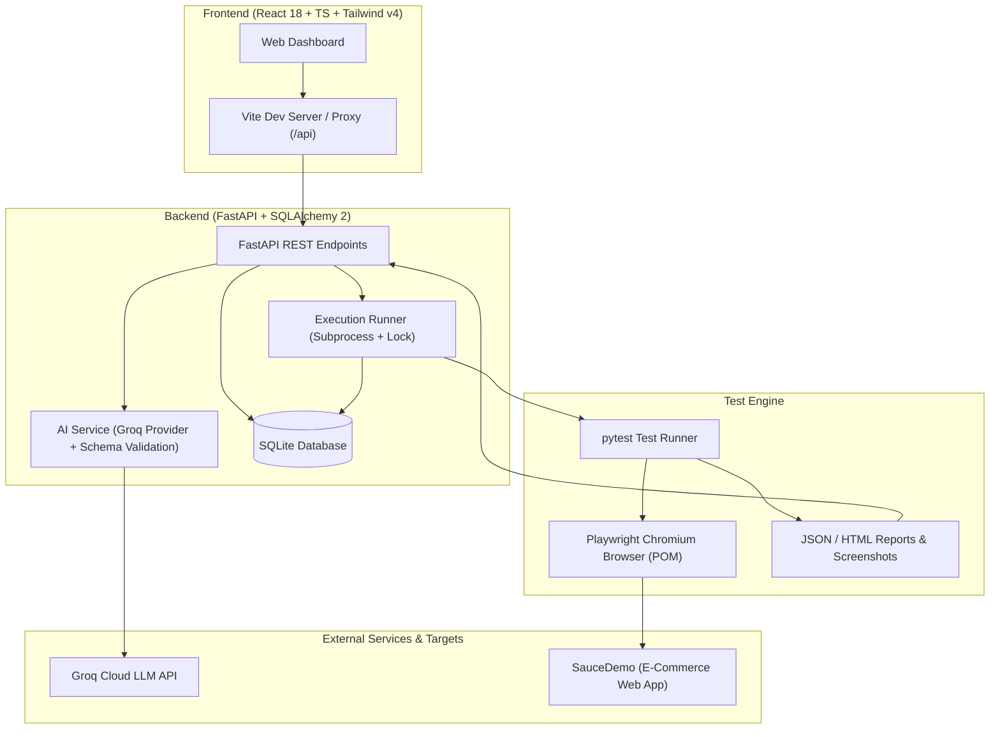

# 🧪 AI-Powered QA Workbench

<div align="center">

[](https://fastapi.tiangolo.com)
[](https://react.dev)
[](https://www.typescriptlang.org)
[](https://tailwindcss.com)
[](https://playwright.dev)
[](https://pytest.org)
[](https://groq.com)
[](https://sqlite.org)

**An intelligent, end-to-end test automation and QA workbench for [SauceDemo](https://www.saucedemo.com)**  
*Requirement Analysis ➔ Test Generation ➔ Human Review ➔ Playwright Execution ➔ Data-Driven Testing ➔ AI Defect Diagnosis ➔ Traceability & Governance*

</div>

---

## 📌 Overview

The **AI-Powered QA Workbench** is a full-stack, enterprise-grade Quality Assurance solution. It augments human QA engineers with generative AI across the entire software testing lifecycle while enforcing strict **Human-in-the-Loop (HITL)** controls, deterministic governance, and zero-hallucination reporting.

Everything displayed in the platform originates from stored database records, real pytest/Playwright runs, or authenticated Groq LLM calls. If the AI service is unavailable, the workbench surfaces clear error states and retry mechanisms rather than mocked/canned responses.

---

## 🚀 Key Features

| Feature | Description |
| :--- | :--- |
| **🔍 Requirement Analyzer** | Parses user stories and acceptance criteria to extract testable requirements, boundary conditions, edge cases, and test strategy insights. |
| **📝 Test Case Generator** | Generates detailed positive, negative, and edge test cases *only* from human-approved requirement analyses. Supports approval, rejection, and manual refinement. |
| **🤖 Test Automation & Execution** | Executes standard Page Object Model (POM) test suites or AI-generated Playwright scripts inside a controlled execution runner with real-time logs and screenshot capture. |
| **📊 Data-Driven Testing (DDT)** | Ingests CSV datasets (e.g. valid/invalid credentials) to execute parameterized tests against SauceDemo with per-row Expected vs. Actual outcome tracking. |
| **🩺 AI Defect Analysis** | Analyzes execution failure logs, assertion errors, and metadata to suggest root cause hypotheses, reproducible steps, severity, and remediation advice. |
| **📈 Reports & Evidence** | Generates interactive pytest HTML reports, execution summaries, failure logs, and automated Playwright screenshots. |
| **🔗 Traceability Matrix (RTM)** | Real-time requirement-to-test-case-to-execution mapping ensuring complete coverage and auditability. |
| **🛡️ AI Governance Ledger** | Central ledger tracking every AI-generated artifact, status (`pending`, `approved`, `rejected`), schema validation outcome, and human review decisions. |

---

## 🏗️ Architecture



---

## 🌿 Repository Branch Structure

This repository is organized into dedicated branches for development clarity and modularity:

| Branch | Purpose & Contents |
| :--- | :--- |
| **`main`** | **Production-ready, integrated full-stack codebase.** Contains backend, frontend, documentation, Playwright automation suites, and verified submission artifacts. |
| **`backend`** | **Backend-focused branch.** Contains the FastAPI application, SQLAlchemy models, Groq AI pipeline, test suites, and Playwright Page Object Model automation. |
| **`frontend`** | **Frontend-focused branch.** Contains the React 18 single-page application, TypeScript interfaces, Tailwind CSS v4 design system, and custom UI components. |

---

## 💻 Tech Stack

- **Frontend:** React 18, TypeScript, Vite, Tailwind CSS v4, Lucide Icons, Axios
- **Backend:** Python 3.11+, FastAPI, Pydantic v2, SQLAlchemy 2 (Sync), SQLite
- **Test Automation:** Playwright (Sync), pytest, pytest-html, pytest-json-report
- **AI Engine:** Groq API (`openai/gpt-oss-120b` or compatible model via `AIProvider`)
- **Target Application:** [SauceDemo](https://www.saucedemo.com) by Sauce Labs

---

## 🛠️ Prerequisites

Ensure you have installed:
- **Python 3.11+**
- **Node.js 20+** and `npm`
- **Git**
- **Groq API Key** (Obtain a free API key at [console.groq.com](https://console.groq.com))
- Stable Internet connection (for SauceDemo and Groq API calls)

---

## ⚙️ Quick Start

### 1. Clone the Repository
```bash
git clone https://github.com/MrPavanBadiger3/AI-POWERED-QA-WORKBENCH.git
cd AI-POWERED-QA-WORKBENCH
```

### 2. Backend Setup

#### Windows (PowerShell)
```powershell
cd backend
python -m venv .venv
.\.venv\Scripts\Activate.ps1
pip install -r requirements.txt
python -m playwright install chromium
Copy-Item .env.example .env
```

#### macOS / Linux
```bash
cd backend
python3 -m venv .venv
source .venv/bin/activate
pip install -r requirements.txt
python -m playwright install chromium   # Linux: python -m playwright install --with-deps chromium
cp .env.example .env
```

> **Important:** Open `backend/.env` in your editor and insert your Groq API key:
> ```env
> GROQ_API_KEY=gsk_your_actual_key_here
> GROQ_MODEL=openai/gpt-oss-120b
> ```

### 3. Frontend Setup
```bash
cd ../frontend
npm install
```

---

## 🏃 Running the Application

Start the backend and frontend in separate terminals:

### Terminal 1: Backend API
```bash
cd backend
# Ensure virtual environment is active
uvicorn app.main:app --reload --port 8000
```
- **API Root:** `http://localhost:8000`
- **Interactive Swagger Docs:** `http://localhost:8000/docs`

### Terminal 2: Frontend Dashboard
```bash
cd frontend
npm run dev
```
- **Application UI:** `http://localhost:5173`

> **Tip:** Upon opening the frontend, navigate to **Settings** and click **Test AI connection** to confirm your Groq API key is valid and responsive.

---

## 🧪 Running Automated Tests

Run the following test commands from the `backend/` directory with your virtual environment activated:

```bash
# 1. Run unit & API test suite (Uses mock AI doubles; fast and isolated)
pytest tests -v

# 2. Run real Playwright browser automation against SauceDemo
pytest automation/tests -v

# 3. Run Data-Driven Testing (CSV-driven login scenarios)
pytest automation/tests/test_data_driven.py -v
```

### Automation Environment Variables
- `QA_BASE_URL` - Target site URL (defaults to `https://www.saucedemo.com`)
- `QA_HEADLESS=0` - Launch visible browser window to watch live automation
- `QA_LOGIN_DATASET` - Path to custom CSV dataset for data-driven testing

---

## 📂 Project Directory Layout

```
AI-POWERED-QA-WORKBENCH/
├── backend/
│   ├── app/
│   │   ├── api/             # FastAPI route controllers (requirements, testcases, executions, etc.)
│   │   ├── core/            # Configuration, settings, and custom error handlers
│   │   ├── database/        # SQLite connection and session management
│   │   ├── models/          # SQLAlchemy ORM entity definitions
│   │   ├── schemas/         # Pydantic request/response schemas
│   │   └── services/        # Core business logic (AI pipeline, runner, linking, reporting)
│   ├── automation/          # Playwright test automation engine
│   │   ├── pages/           # Page Object Models (LoginPage, InventoryPage, CartPage)
│   │   ├── tests/           # Playwright pytest suites (Login, E2E, Data-Driven)
│   │   ├── test_data/       # CSV test datasets
│   │   └── generated/       # Approved AI-generated test scripts
│   ├── reports/             # Execution reports, logs, and HTML summaries
│   ├── screenshots/         # Automated failure screenshots
│   └── tests/               # Backend API integration and unit tests
├── frontend/
│   ├── src/
│   │   ├── components/      # Reusable UI components & modals
│   │   ├── layouts/         # App layout, navigation sidebar, and header
│   │   ├── pages/           # Feature pages (Analyzer, Generator, Automation, Defects, RTM, etc.)
│   │   ├── services/        # Axios API client integrations
│   │   └── types/           # TypeScript domain definitions
├── artifacts/               # Submission deliverables & audit documents
├── docs/                    # Architecture, demo guide, prompts, and limitations
├── .env.example             # Safe template for environment variables
└── README.md                # Project documentation
```

---

## 🔒 Security & Safe AI Principles

- **No Secret Leakage:** The Groq API key resides exclusively in `backend/.env` (which is strictly git-ignored) and is never returned in HTTP responses.
- **AST Script Allow-listing:** AI-generated test automation scripts undergo Python Abstract Syntax Tree (AST) inspection to disallow prohibited system calls, dynamic imports, or arbitrary shell execution.
- **Execution Command Whitelisting:** The test execution runner permits only predefined test suites and vetted CSV datasets.
- **Strict Pydantic Validation:** All AI completions are parsed into strict Pydantic schemas. Invalid outputs trigger fallback validation errors and are logged in the AI Governance ledger.

---

## 📄 License & Attribution

This project is built for professional QA evaluation and educational demonstrations against Sauce Labs' public [SauceDemo](https://www.saucedemo.com) testbed. All rights reserved.
