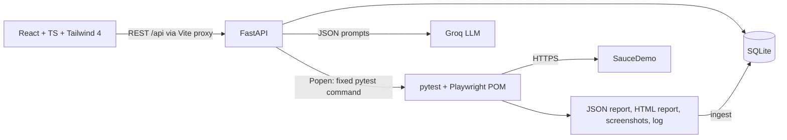

# Architecture - AI-Powered QA Workbench

## Stack and why
| Layer | Choice | Reason |
|---|---|---|
| Frontend | React 18, TypeScript, Vite, Tailwind 4, lucide, axios | Typed contracts, fast dev loop, v4 `@import "tailwindcss"` |
| Backend | FastAPI, Pydantic v2, SQLAlchemy 2 (sync) + SQLite | Simple, auto Swagger, no async-DB complexity for a local single-user app |
| AI | Groq via `AIProvider` interface (`ai_service.py`) | Swap providers by implementing one method |
| Automation | Playwright (sync) + pytest + POM, pytest-html, pytest-json-report | Real browser, machine-readable results |
| Execution | thread + `subprocess.Popen` | Works on Windows/macOS/Linux (no asyncio-subprocess pitfalls) |

## Backend modules
- `core/` settings (`.env`), monotonic ID counters, error handlers.
- `models/` tables: requirements, test_cases, automation_scripts, executions, test_results, defect_reports, generated_documents, ai_artifacts (governance ledger), id_counters.
- `services/ai/`: `prompts.py` (all prompts, shared governance rules) · `ai_service.py` (provider, typed `AIError`) · `schemas_ai.py` (Pydantic output models + deterministic governance checks) · `pipeline.py` (`run_ai` → parse → validate → ledger).
- `services/execution/runner.py`: suite whitelist, single-run lock, process + timeout + tree kill, ingestion, restart recovery.
- `services/testcases/`: `linking.py` (test case ↔ automated test, latest status), `script_safety.py` (AST allow-list).
- `services/defects`, `services/reporting` (dashboard, RTM, summary HTML, documentation, artifact export).
- `api/` thin routers: requirements, testcases, automation, executions, data_driven, defects, reporting, documentation, governance, health.

## Key flows
**AI call:** router → `run_ai(prompt_key)` → provider → `parse_json_object` → Pydantic model → governance checks → persist entity + `AIArtifact` (status `pending`). Malformed/invalid output → HTTP 422, nothing stored except a `failed` ledger row. Provider errors map to 503 (no key), 502 (auth/network/model), 429 (rate limit), 504 (timeout) with `{detail, code, retryable}`; the UI shows a Retry button.

**Human review:** every AI entity starts `pending`; approve/reject/needs-modification updates the entity and its ledger row. Editing approved content returns it to review. Test cases only generate from an *approved* analysis; scripts only from *approved* test cases; only *approved* scripts are written to `automation/generated/` and run.

**Execution:** `POST /api/executions/run {suite, dataset?}` → whitelist check → 409 if another run is active → `Execution` row → thread runs `python -m pytest <fixed targets> --json-report --html` with env (`QA_LOGIN_DATASET`, …) → log file → on exit parse JSON → `TestResult` rows (status, duration, error, logs, screenshot name, per-row data evidence) → counts. The UI polls `GET /api/executions/{id}` + `/results` + `/logs` every 2 s.

**Evidence capture:** `automation/conftest.py` hooks test failure, screenshots the Playwright page, records the file name in `json_metadata` (and embeds it in pytest-html). Data-driven rows record username/expected/actual in metadata.

**Defect analysis:** client sends only `test_result_id`; backend loads stored error/log/metadata, the linked test case's expected result, and a heuristic category hint (labelled unverified) and sends that to the AI. Output is validated; root cause is forced to start with "Hypothesis:"; `screenshot_analyzed` is always `false` for the text model.

**Traceability:** computed on request from `test_cases.requirement_id`, `status`, `automation_ref` and the newest matching `TestResult`.

## Data model relationships
Requirement 1─* TestCase 1─* AutomationScript · Execution 1─* TestResult · DefectReport → TestResult/Execution/TestCase (by id) · AIArtifact → any entity by `(artifact_type, reference_id)`.

## Security
Key only in `backend/.env`; never returned. Whitelisted suites/datasets; no shell strings; screenshot endpoint serves basenames from one folder; CSV uploads validated; CORS limited to local dev origins.
